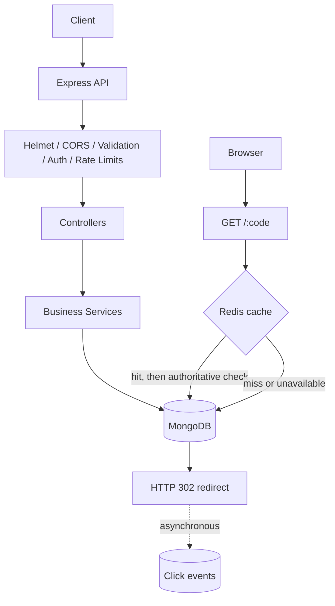
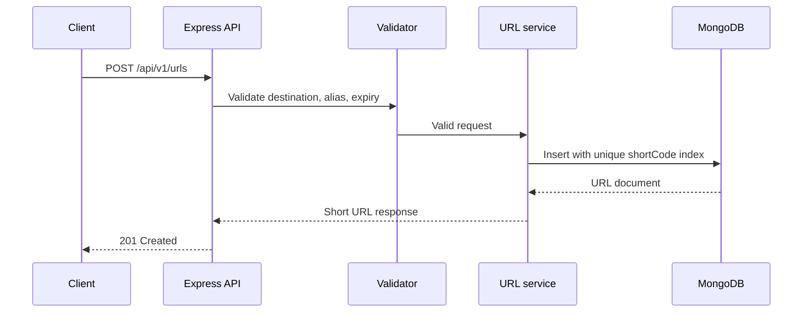
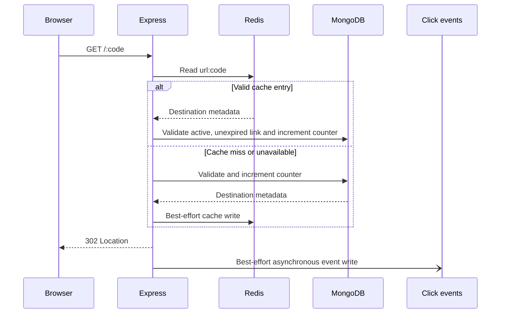

# URL Shortener

A production-style URL shortener backend implemented as a modular monolith with Node.js, Express, MongoDB, Redis, JWT authentication, and automated tests.

## Features

- Create HTTP/HTTPS short URLs.
- Generate cryptographically secure short codes.
- Create validated custom aliases.
- Optional link expiration.
- Temporary `302` redirects.
- Optional Redis cache-aside redirect lookup.
- User registration, login, and JWT authentication.
- Owner-only URL listing, inspection, updates, and deletion.
- Click counters and asynchronous click-event analytics.
- Helmet, explicit CORS, JSON size limits, and rate limiting.
- Docker Compose development stack.
- GitHub Actions CI.

## Technology stack

- Node.js 22+
- Express 5
- MongoDB with Mongoose
- Redis with the official `redis` client
- bcryptjs and jsonwebtoken
- Zod validation
- Vitest and Supertest
- Docker and GitHub Actions

## Architecture



Controllers are intentionally thin. Services contain business rules, while Mongoose models define persistence and indexes. MongoDB remains authoritative even when Redis is available.

## Request flows

### Create a URL



### Redirect



## API reference

### Operational

| Method | Endpoint | Description |
|---|---|---|
| `GET` | `/health` | Service and MongoDB connection status |

### Authentication

| Method | Endpoint | Auth |
|---|---|---|
| `POST` | `/api/v1/auth/register` | No |
| `POST` | `/api/v1/auth/login` | No |
| `GET` | `/api/v1/auth/me` | Bearer JWT |

### URL management

| Method | Endpoint | Auth |
|---|---|---|
| `POST` | `/api/v1/urls` | Optional |
| `GET` | `/api/v1/urls?page=1&limit=20` | Bearer JWT |
| `GET` | `/api/v1/urls/:code` | Bearer JWT, owner |
| `PATCH` | `/api/v1/urls/:code` | Bearer JWT, owner |
| `DELETE` | `/api/v1/urls/:code` | Bearer JWT, owner |
| `GET` | `/api/v1/urls/:code/stats?days=30&limit=20` | Bearer JWT, owner |

`PATCH` accepts `isActive` and/or `expiresAt`. Anonymous links can redirect, but they are not owner-managed in the current implementation.

### Redirect

| Method | Endpoint | Description |
|---|---|---|
| `GET` | `/:code` | Returns a temporary `302` redirect |

## Response format

Successful responses use:

```json
{
  "success": true,
  "data": {}
}
```

Errors use:

```json
{
  "success": false,
  "error": {
    "code": "URL_NOT_FOUND",
    "message": "The requested short URL was not found."
  }
}
```

## Database schema and indexes

### Users

- `name`
- normalized, unique `email`
- `passwordHash`
- timestamps

### URLs

- unique indexed `shortCode`
- `originalUrl`
- optional `userId`
- optional `customAlias`
- optional `expiresAt`
- `isActive`
- `clickCount`
- timestamps

### Click events

- indexed `urlId`
- indexed `clickedAt`
- compound `{ urlId: 1, clickedAt: -1 }`
- optional bounded `referrer`
- optional bounded `userAgent`

`clickCount` supports fast totals. Click events support time-series and summary analytics. These writes are intentionally separate in the current modular-monolith implementation.

## Environment variables

Copy `.env.example` to `.env` for local non-Docker development:

| Variable | Required | Description |
|---|---:|---|
| `NODE_ENV` | No | `development` or `production` |
| `PORT` | No | HTTP port, default `3000` |
| `MONGODB_URI` | Yes | MongoDB connection string |
| `BASE_URL` | No | Base URL used in generated short URLs |
| `SHORT_CODE_LENGTH` | No | Code length, 4–32, default `7` |
| `MAX_CODE_GENERATION_ATTEMPTS` | No | Collision retry limit |
| `CORS_ORIGINS` | No | Comma-separated allowed browser origins |
| `JSON_BODY_LIMIT` | No | Express JSON limit, default `10kb` |
| `URL_CREATION_RATE_LIMIT_WINDOW_MS` | No | Rate-limit window |
| `URL_CREATION_RATE_LIMIT_MAX` | No | Requests per window and IP |
| `JWT_SECRET` | Auth | Long random signing secret |
| `JWT_EXPIRES_IN` | No | JWT lifetime, default `1h` |
| `REDIS_URL` | No | Redis connection string; omit to disable cache |
| `REDIS_CACHE_TTL_SECONDS` | No | Maximum cache TTL |

Never commit `.env` or production credentials.

## Local setup

For a complete local Docker walkthrough, see [README-LOCAL.md](./README-LOCAL.md).

For production Docker and GitHub Actions deployment, see [README-DEPLOYMENT.md](./README-DEPLOYMENT.md).

```powershell
npm install
Copy-Item .env.example .env
npm test
npm start
```

The application requires a reachable MongoDB instance before it starts listening.

## Docker Compose

Docker Compose starts the API, MongoDB, and Redis:

```powershell
$env:JWT_SECRET = "use-a-long-random-local-secret"
docker compose up --build
```

Stop the stack:

```powershell
docker compose down
```

Remove local MongoDB data only when intentionally resetting development data:

```powershell
docker compose down -v
```

## Testing and CI

Run the local test suite:

```powershell
npm test
```

The CI workflow in `.github/workflows/ci.yml` runs dependency installation, auditing, JavaScript syntax checks, and tests on pushes and pull requests.

## Deployment checklist

Before deploying:

1. Provision MongoDB with network restrictions and authentication.
2. Provision Redis with authentication and private networking if caching is enabled.
3. Set a long, random `JWT_SECRET`.
4. Set `NODE_ENV=production`.
5. Configure `BASE_URL` and exact `CORS_ORIGINS`.
6. Configure a TLS-terminating reverse proxy or managed load balancer.
7. Expose only the API port; do not expose MongoDB or Redis publicly.
8. Configure logs, uptime monitoring, and alerts for `/health`.
9. Run database backups and test restoration.
10. Configure secret storage through the deployment platform, not image layers or Git.
11. Review rate limits and resource limits for expected traffic.
12. Deploy the image built from a reviewed commit.

The Docker image runs as a non-root user. The included Compose file is intended for local development and is not a complete production orchestration configuration.

## Security decisions

- Only HTTP and HTTPS destinations are accepted.
- User-provided URLs are not fetched automatically, avoiding SSRF in the current scope.
- MongoDB unique indexes enforce code and email uniqueness under concurrency.
- JWT-protected resources enforce ownership in database filters.
- Passwords are bcrypt-hashed.
- Helmet and explicit CORS configuration are enabled.
- URL creation is rate-limited.
- Production errors use generic messages for unexpected failures.
- Redis entries are checked for active and expiration state and bounded by link expiry.
- No IP addresses are stored in click events.

## Known limitations and future improvements

- Anonymous links have no owner-management workflow.
- Click-event insertion is best-effort and asynchronous; a durable queue could prevent event loss.
- Redis is optional and currently uses a single client without clustering or distributed cache metrics.
- Rate limiting uses the process-local default store; production deployments with multiple instances should use a shared store.
- No background cleanup job removes old click events.
- No password reset, email verification, refresh-token rotation, or account deletion flow exists yet.
- API documentation generation with OpenAPI/Swagger remains a future improvement.
- Capacity estimates and load benchmarks have not been performed, so production throughput is not claimed.
