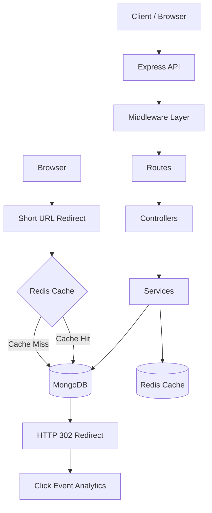
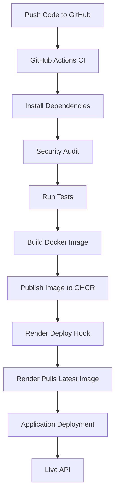

# URL Shortener with Analytics

A production-style URL shortening backend built with **Node.js, Express.js, MongoDB, and Redis**. Create short links, manage URLs, track clicks, and explore link analytics through a modular backend architecture.

<p align="center">
  <a href="https://url-shortener-with-analytics-latest.onrender.com">Live API</a> •
  <a href="https://github.com/arcadenarendra/URL-shortener-with-analytics">GitHub Repository</a>
</p>

---

## Overview

URL Shortener with Analytics is a backend application that converts long URLs into compact, shareable links while providing URL management, authentication, and click analytics.

The project follows a modular monolith architecture, separating routes, controllers, services, middleware, validation, and database models.

It also includes Docker containerization and an automated CI/CD pipeline that builds and publishes Docker images to GitHub Container Registry (GHCR) before triggering deployment on Render.

## Key Features

- **URL Shortening:** Convert long HTTP/HTTPS URLs into short links.
- **Secure Short Codes:** Generate cryptographically secure short codes.
- **Custom Aliases:** Create personalized short URLs.
- **Link Expiration:** Configure optional expiration dates.
- **URL Redirection:** Redirect users using HTTP 302 responses.
- **Authentication:** User registration, login, and JWT-based authentication.
- **URL Management:** View, update, and delete owned URLs.
- **Click Analytics:** Track click counts and store click events.
- **Redis Caching:** Optional cache-aside strategy for faster redirect lookups.
- **Input Validation:** Validate incoming requests using Zod.
- **Security:** Helmet, CORS configuration, password hashing, and rate limiting.
- **Docker Support:** Containerized application with Docker Compose.
- **Automated CI/CD:** GitHub Actions, GHCR, and Render deployment.

## Live Deployment

| Resource | Link |
|---|---|
| Live API | https://url-shortener-with-analytics-latest.onrender.com |
| Health Check | [API Health](https://url-shortener-with-analytics-latest.onrender.com/health) |
| GitHub Repository | [View Source Code](https://github.com/arcadenarendra/URL-shortener-with-analytics) |
| Docker Registry | `ghcr.io/arcadenarendra/url-shortener-with-analytics` |

The application is deployed as a Docker-based web service on Render. MongoDB Atlas is used as the external database.

> Note: The live service may take some time to respond after inactivity depending on the Render plan.

## Technology Stack

| Category | Technology |
|---|---|
| Runtime | Node.js 22+ |
| Backend | Express.js 5 |
| Database | MongoDB |
| ODM | Mongoose |
| Cache | Redis |
| Authentication | JWT |
| Password Hashing | bcryptjs |
| Validation | Zod |
| Testing | Vitest, Supertest |
| Containerization | Docker, Docker Compose |
| CI/CD | GitHub Actions |
| Container Registry | GitHub Container Registry |
| Deployment | Render |

## System Architecture

The application uses a layered architecture to separate HTTP handling, business logic, and data persistence.



### Architecture Principles

- **Routes:** Define API endpoints and connect them to controllers.
- **Controllers:** Handle HTTP requests and responses.
- **Services:** Contain application business logic.
- **Models:** Define MongoDB schemas and indexes.
- **Middleware:** Handle authentication, validation, security, and rate limiting.
- **Redis:** Provides optional caching for redirect lookups.
- **MongoDB:** Remains the authoritative data store.

## Project Structure

```text
URL-shortener-with-analytics/
│
├── .github/
│   └── workflows/
│       ├── ci.yml
│       └── cd.yml
│
├── docs/
│
├── src/
│   ├── config/
│   ├── controllers/
│   ├── middleware/
│   ├── models/
│   │   ├── clickEvent.model.js
│   │   ├── url.model.js
│   │   └── user.model.js
│   ├── routes/
│   ├── services/
│   ├── utils/
│   ├── validators/
│   ├── app.js
│   └── server.js
│
├── tests/
│
├── .dockerignore
├── .env.example
├── .gitignore
├── Dockerfile
├── docker-compose.yml
├── docker-compose.prod.yml
├── package.json
├── README.md

```

## API Documentation

Base URL:

```text
https://url-shortener-with-analytics-latest.onrender.com
```

### 1. Health Check

| Method | Endpoint | Authentication |
|---|---|---|
| GET | `/health` | No |

Checks application and database connection status.

### 2. Authentication

| Method | Endpoint | Authentication |
|---|---|---|
| POST | `/api/v1/auth/register` | No |
| POST | `/api/v1/auth/login` | No |
| GET | `/api/v1/auth/me` | Bearer Token |

### 3. URL Management

| Method | Endpoint | Authentication |
|---|---|---|
| POST | `/api/v1/urls` | Optional |
| GET | `/api/v1/urls` | Bearer Token |
| GET | `/api/v1/urls/:code` | Owner |
| PATCH | `/api/v1/urls/:code` | Owner |
| DELETE | `/api/v1/urls/:code` | Owner |
| GET | `/api/v1/urls/:code/stats` | Owner |

Pagination example:

```http
GET /api/v1/urls?page=1&limit=20
```

Analytics example:

```http
GET /api/v1/urls/:code/stats?days=30&limit=20
```

### 4. URL Redirection

| Method | Endpoint | Description |
|---|---|---|
| GET | `/:code` | Redirect to original URL |

Successful redirects use HTTP `302 Found`.

### Authentication Header

For protected endpoints:

```http
Authorization: Bearer YOUR_JWT_TOKEN
```

## Example API Requests

### Register a User

```http
POST /api/v1/auth/register
Content-Type: application/json
```

```json
{
  "name": "John Doe",
  "email": "john@example.com",
  "password": "strong-password-123"
}
```

### Login

```http
POST /api/v1/auth/login
Content-Type: application/json
```

```json
{
  "email": "john@example.com",
  "password": "strong-password-123"
}
```

### Create a Short URL

```http
POST /api/v1/urls
Content-Type: application/json
Authorization: Bearer YOUR_JWT_TOKEN
```

```json
{
  "originalUrl": "https://example.com",
  "customAlias": "my-link"
}
```

The `customAlias` field is optional.

### Update a Short URL

```http
PATCH /api/v1/urls/my-link
Authorization: Bearer YOUR_JWT_TOKEN
Content-Type: application/json
```

```json
{
  "isActive": false
}
```

### Response Format

Successful response:

```json
{
  "success": true,
  "data": {}
}
```

Error response:

```json
{
  "success": false,
  "error": {
    "code": "URL_NOT_FOUND",
    "message": "The requested short URL was not found."
  }
}
```

## Database Design

The application uses MongoDB with three primary collections.

### Users

Stores user account information.

- `name`
- `email`
- `passwordHash`
- `timestamps`

### URLs

Stores shortened URL information.

- `shortCode`
- `originalUrl`
- `userId`
- `customAlias`
- `expiresAt`
- `isActive`
- `clickCount`
- `timestamps`

### Click Events

Stores click analytics information.

- `urlId`
- `clickedAt`
- `referrer`
- `userAgent`

Indexes are used to support efficient URL lookups, unique short codes, and analytics queries.

## CI/CD Pipeline

The project uses GitHub Actions to automate testing, Docker image publishing, and deployment.

### Deployment Architecture



### CI — Continuous Integration

Triggered by pushes and pull requests.

The CI workflow performs:

- Repository checkout.
- Node.js environment setup.
- Dependency installation using `npm ci`.
- Dependency security audit using `npm audit`.
- JavaScript syntax validation.
- Automated test execution.

### CD — Continuous Deployment

Triggered by pushes to the `main` branch.

The CD workflow performs:

1. Verify dependencies and run tests.
2. Build the Docker image.
3. Tag the image with `latest` and the commit SHA.
4. Publish the image to GitHub Container Registry.
5. Trigger Render deployment through a Deploy Hook.
6. Render deploys the newly published image.

### Docker Image

```text
ghcr.io/arcadenarendra/url-shortener-with-analytics:latest
```

### Required GitHub Secret

| Secret | Purpose |
|---|---|
| `RENDER_DEPLOY_HOOK_URL` | Triggers Render deployment |

GHCR publishing uses the GitHub Actions `GITHUB_TOKEN`.

Production database credentials and JWT secrets are configured in Render's environment settings, not committed to the repository.

## Local Development Setup

### Prerequisites

- Node.js 22 or later
- npm
- MongoDB instance
- Git
- Docker Desktop (optional)

### 1. Clone the Repository

```bash
git clone https://github.com/arcadenarendra/URL-shortener-with-analytics.git

cd URL-shortener-with-analytics
```

### 2. Install Dependencies

```bash
npm install
```

### 3. Configure Environment Variables

Copy the example environment file:

```bash
cp .env.example .env
```

On Windows PowerShell:

```powershell
Copy-Item .env.example .env
```

Configure your MongoDB connection string and other required variables.

### 4. Start the Application

```bash
npm start
```

The API uses port `3000` by default unless another port is configured.

### 5. Run Tests

```bash
npm test
```

## Environment Variables

Configure the following variables in your `.env` file or deployment platform.

| Variable | Required | Description |
|---|---|---|
| `NODE_ENV` | No | Application environment |
| `PORT` | No | Server port; defaults to `3000` |
| `MONGODB_URI` | Yes | MongoDB connection string |
| `BASE_URL` | No | Base URL used to generate short links |
| `SHORT_CODE_LENGTH` | No | Generated short-code length |
| `MAX_CODE_GENERATION_ATTEMPTS` | No | Collision retry limit |
| `CORS_ORIGINS` | No | Comma-separated allowed origins |
| `JSON_BODY_LIMIT` | No | Express JSON payload limit |
| `JWT_SECRET` | For authentication | JWT signing secret |
| `JWT_EXPIRES_IN` | No | JWT expiration duration |
| `REDIS_URL` | No | Redis connection string |
| `REDIS_CACHE_TTL_SECONDS` | No | Redis cache TTL |
| `URL_CREATION_RATE_LIMIT_WINDOW_MS` | No | URL creation rate-limit window |
| `URL_CREATION_RATE_LIMIT_MAX` | No | Maximum URL creation requests |
 
Never commit `.env` files, database credentials, or production secrets.

## Docker Setup

Run the complete local development stack using Docker Compose.

```bash
docker compose up --build -d
```

Check running services:

```bash
docker compose ps
```

View API logs:

```bash
docker compose logs -f api
```

Stop containers:

```bash
docker compose down
```

To remove local database volumes, use `docker compose down -v` only when intentionally resetting local development data.

For detailed instructions, see [README-LOCAL.md](README-LOCAL.md).

## Security Considerations

Security measures implemented in the application include:

- Password hashing using bcrypt.
- JWT-based authentication.
- Protected owner-specific URL operations.
- Request validation using Zod.
- HTTP security headers using Helmet.
- Explicit CORS configuration.
- Rate limiting for URL creation.
- MongoDB unique indexes.
- Production-safe error responses.
- HTTP and HTTPS destination validation.
- No automatic fetching of user-provided destination URLs.

MongoDB remains the authoritative data store when Redis caching is enabled.

## Known Limitations

- Anonymous URLs do not currently have an owner-management workflow.
- Click-event insertion is asynchronous and best-effort.
- Redis currently uses a single client without clustering.
- Rate limiting uses a process-local store.
- No password reset or email verification workflow.
- No refresh-token rotation or account deletion workflow.
- OpenAPI/Swagger documentation is not yet integrated.
- Formal load testing and capacity benchmarks have not been performed.

## Future Improvements

- Swagger/OpenAPI documentation.
- Frontend dashboard for URL management.
- Advanced analytics visualizations.
- Geographic analytics where privacy-appropriate.
- Distributed rate limiting with Redis.
- Background cleanup for expired URLs and old click events.
- Durable asynchronous analytics processing.
- Password reset and email verification.
- Automated integration and load testing.

## Contributing

Contributions and suggestions are welcome.

1. Fork the repository.
2. Create a feature branch.
3. Make your changes.
4. Run the automated tests.
5. Submit a pull request.

## Author

**Narendra Prajapati**

- GitHub: [@arcadenarendra](https://github.com/arcadenarendra)
- Project: [URL Shortener with Analytics](https://github.com/arcadenarendra/URL-shortener-with-analytics)
- Live API: [Render Deployment](https://url-shortener-with-analytics-latest.onrender.com)

---

<p align="center">
  Built with Node.js, Express, MongoDB, Redis, Docker, and GitHub Actions.
</p>